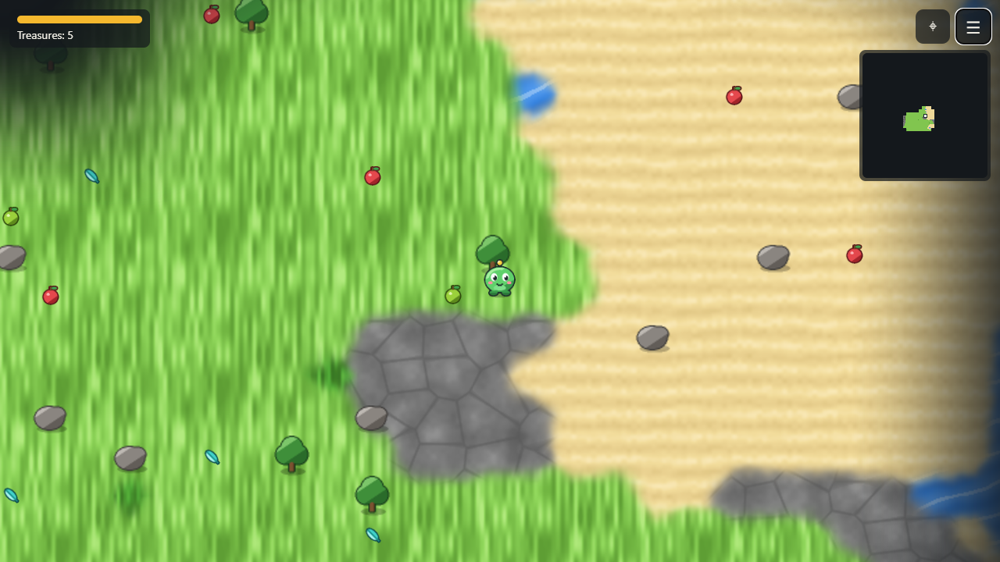

# Gizmo's World

A cozy exploration game in the making: wander an endless, procedurally generated world with
Gizmo, discover biomes and collect treasures. Terrain is textured and blended procedurally,
villages have roofed houses, and a fog of war lifts as you explore.

> **Status: tech demo.** This is not a complete game yet. There are no quests, characters or
> goals beyond exploring and collecting. It shows the foundation the full game will be built
> on: world generation, rendering, movement, saves and the minimap.

## Controls

- **Move:** WASD or arrow keys; on touch screens, drag on the left side of the screen
- **Minimap:** M or the ⌖ button
- **Menu** (new world, export/import save): ☰ button
- **Debug overlay:** F3 or `?debug` in the URL; B tints biomes while it is open

## Develop

    npm install
    npm run dev       # http://localhost:5173 (add ?debug for the debug overlay, F3 toggles it)
    npm test
    npm run lint
    npm run build     # static site in dist/

## Deploy

Pushing to `master` or `main` on GitHub runs `.github/workflows/deploy.yml`, which lints, tests,
builds and publishes to GitHub Pages. Enable Pages with "GitHub Actions" as the source in the repo
settings. For itch.io, zip the contents of `dist/` and upload it as an HTML game.

## Layout

- `src/core` — RNG, noise, LRU, game loop
- `src/data` — content tables (biomes, terrains, items, blocks, buildings)
- `src/world` — deterministic world generation and chunk cache
- `src/systems` — movement, energy, effects, pickups, discovery
- `src/render` — procedural textures, terrain blending, chunk baking, sprites, fog, minimap
- `src/ui`, `src/input`, `src/save` — HUD/menu, controls, save files

Design docs live in `docs/superpowers/`.

## License

MIT — see [LICENSE](LICENSE).
